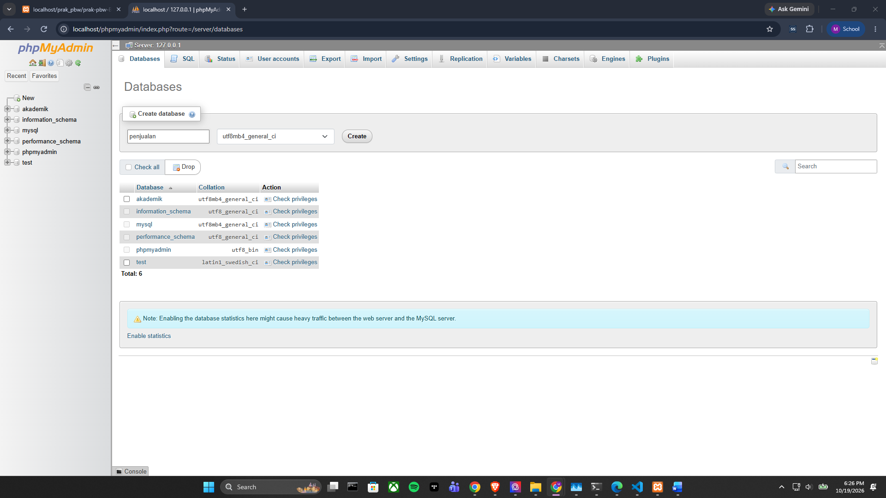
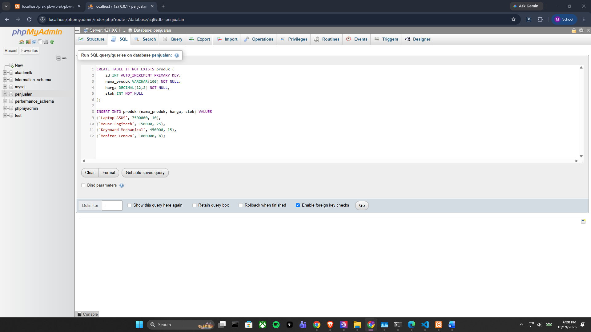
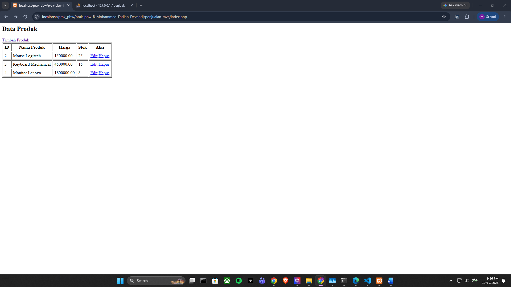
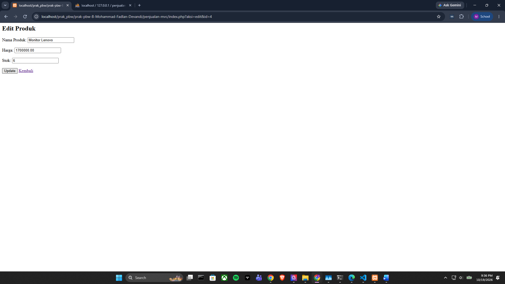
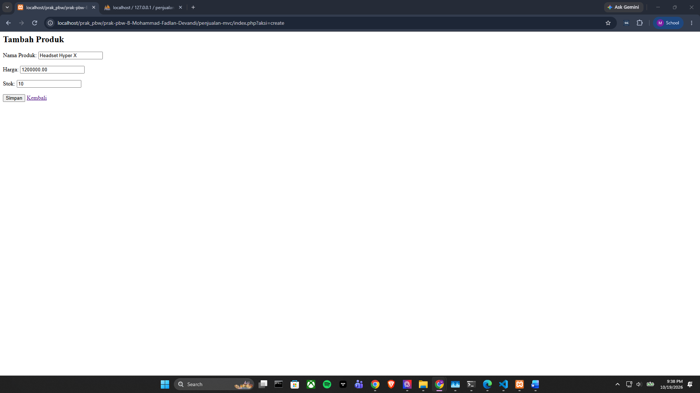
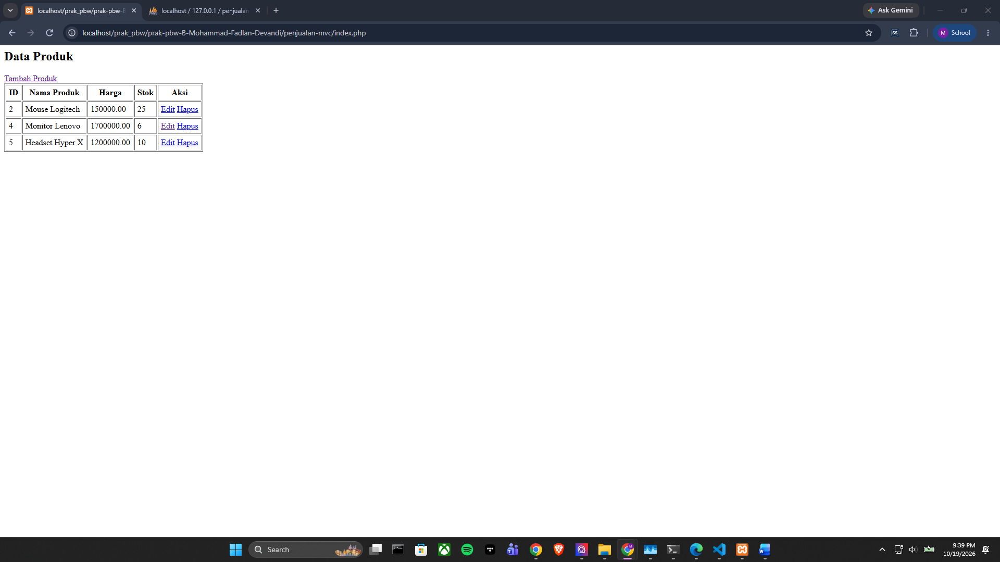
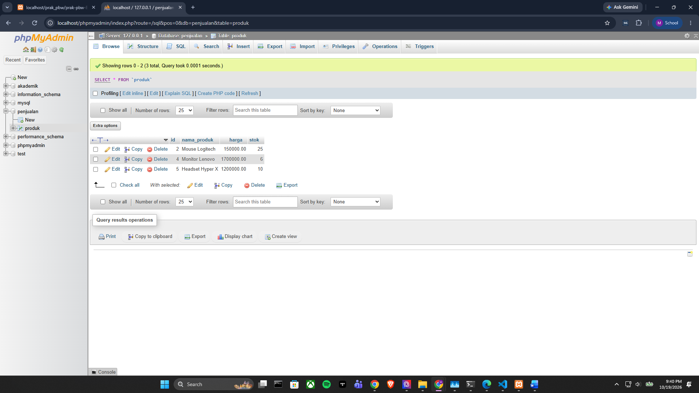

# LAPORAN PRAKTIKUM
# PEMROGRAMAN BERBASIS WEB

---

# TUGAS 7

# 1. Buat Database Penjualan

## Membuat Database

## Tabel Mengisi Database Penjualan

# 2. Hasil Run

## Tampilan Utama

## Tampilan Edit

## Tampilan Menambah Produk

## Tampilan Jika Menghapus Salah Satu Produk
### "Menghapus Produk Keyboard Mechanical

# 3. Tampilan Database
## Hasail Database Setelah Diedit, Menambah Produk dan Menghapus Produk

